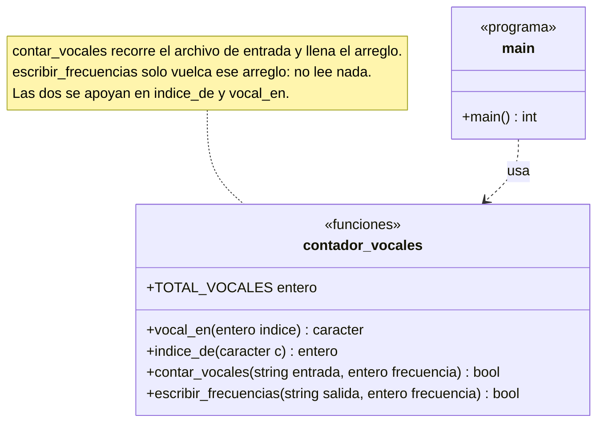
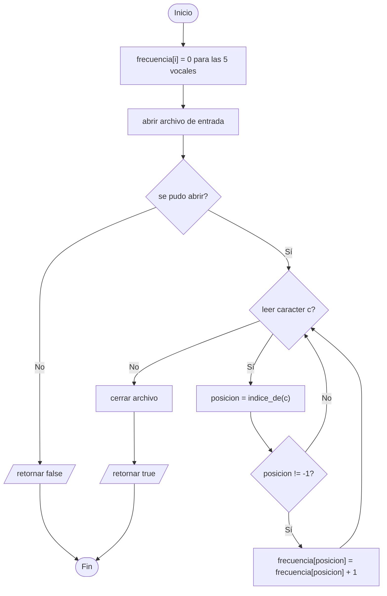

# A1 – Contador de vocales (sesión 14A)

> Ejercicio 1 de la sesión 14A: *crear un programa que solicite el nombre de archivo y que cuente las vocales del archivo y genere otro archivo cuyo nombre es `vocales.txt`. El archivo debe mostrar (en cada línea) la vocal y su frecuencia.*

Es el primer ejercicio con archivos: **uno se lee y otro se escribe** en el mismo programa.

## Diagrama de funciones



El ejercicio no tiene clases: son cuatro funciones libres declaradas en `contador_vocales.h`. Lo que importa del reparto es que **el archivo de entrada se recorre una sola vez**, dentro de `contar_vocales`. A partir de ahí el programa trabaja con los cinco contadores, y `escribir_frecuencias` nunca vuelve a abrir el texto original.

## Los dos flujos

| Flujo | Clase | Cabecera | Para qué |
|---|---|---|---|
| Entrada | `std::ifstream` | `<fstream>` | leer el archivo que indica el usuario |
| Salida | `std::ofstream` | `<fstream>` | crear `vocales.txt` |

Abrir es construir el objeto con el nombre del archivo:

```cpp
std::ifstream entrada(nombre_entrada);
std::ofstream salida("vocales.txt");
```

Y lo primero después de abrir es **preguntar si se pudo**:

```cpp
if (!entrada) {
    return false;
}
```

`ifstream` falla si el archivo no existe; `ofstream` lo crea si no existe y lo **vacía** si ya existía. Por eso el programa solo avisa cuando falla la lectura.

## La lectura carácter por carácter

```cpp
caracter c;
while (entrada.get(c)) {
    ...
}
```

`get(c)` guarda el siguiente carácter en `c` y devuelve el propio flujo. Un flujo usado como condición vale **falso** cuando la última operación no se pudo hacer, y eso es exactamente lo que ocurre al llegar al final del archivo. Por eso el bucle termina solo, sin preguntar por `eof()`.

Se cuenta carácter por carácter y no palabra por palabra porque una vocal puede estar en cualquier posición dentro de una palabra.

## El arreglo de frecuencias

Cinco vocales, cinco contadores:

| Posición | 0 | 1 | 2 | 3 | 4 |
|---|---|---|---|---|---|
| Vocal | `a` | `e` | `i` | `o` | `u` |

`indice_de(c)` convierte el carácter a minúscula con `tolower` y devuelve su posición, o `-1` si no es vocal. Así `'A'` y `'a'` suman al mismo contador y el resto de caracteres se ignora sin un `if` por cada letra.

## Preguntas de la sesión

| Pregunta | Respuesta |
|---|---|
| ¿Qué diferencia hay entre `ifstream` y `ofstream`? | El primero solo lee, el segundo solo escribe |
| ¿Por qué el `while` no pregunta por el final del archivo? | Porque el flujo ya vale falso cuando no pudo leer |
| ¿Qué pasa si `vocales.txt` ya existía? | Se vacía: `ofstream` abre en modo escritura desde cero |
| ¿Por qué `tolower` antes de comparar? | Para que `'A'` y `'a'` cuenten como la misma vocal |
| ¿Hace falta `close()`? | No: el destructor cierra el archivo. Se escribe para dejarlo explícito |

## Diagrama de flujo – `contar_vocales()`



## Ejecución

```
Ingrese el nombre del archivo: datos/texto.txt

Vocal y frecuencia en el texto:
a: 31
e: 29
i: 10
o: 14
u: 9

Resultado grabado en vocales.txt
```

Contenido de `vocales.txt`:

```
Vocal y frecuencia en el texto:
a: 31
e: 29
i: 10
o: 14
u: 9
```

Si el archivo no existe:

```
Ingrese el nombre del archivo: noexiste.txt
No se pudo abrir el archivo noexiste.txt
```

## Tareas

- [ ] **1. `tipos.h`.** Los `using` de `entero`, `real` y `caracter`.
- [ ] **2. El arreglo de vocales.** `vocal_en(i)` devuelve la vocal de la posición `i`.
- [ ] **3. `indice_de(c)`.** Convierte a minúscula y devuelve la posición, o `-1`. *Pista: `tolower` está en `<cctype>`.*
- [ ] **4. Abrir y verificar.** `ifstream` con el nombre recibido y el `if (!entrada)`.
- [ ] **5. El bucle de lectura.** `while (entrada.get(c))`, sin preguntar por `eof()`.
- [ ] **6. El conteo.** Sumar en el contador que indique `indice_de(c)`.
- [ ] **7. `escribir_frecuencias`.** `ofstream` a `vocales.txt` con una línea por vocal.
- [ ] **8. `main`.** Pedir el nombre, mostrar en pantalla y grabar el archivo.
- [ ] **9. El archivo que no existe.** Probar con un nombre inventado y comprobar el mensaje.
- [ ] **10. Para pensar.** ¿Qué habría que cambiar para contar también consonantes, sin escribir 21 contadores a mano?
