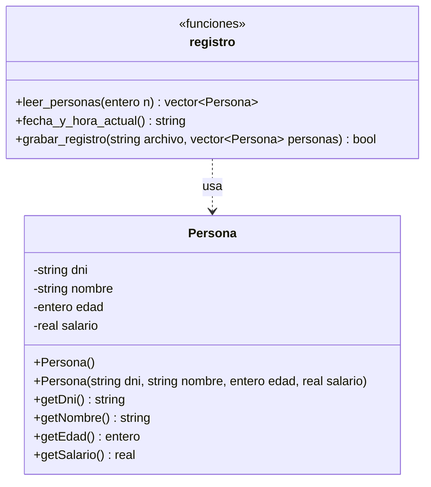
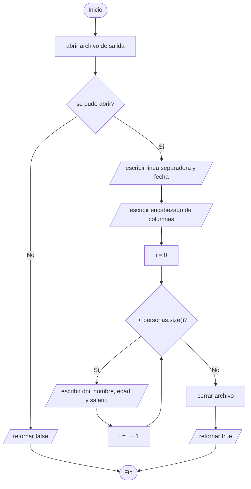

# A2 – Registro de personas (sesión 14A)

> Ejercicio 2 de la sesión 14A: *crear un programa que solicite un número n, nombre de archivo y los datos de "n" personas (dni, nombre, edad, salario). El programa debe grabar esos datos en el archivo. Genere el archivo con la fecha y hora de registro y los datos de las personas.*

Aquí el archivo no se lee: **se produce**. Y se produce con un formato que una persona pueda leer.

## Diagrama de clase



`Persona` solo guarda datos y los devuelve; **no sabe nada de archivos**. Quien escribe es `grabar_registro`. Esa separación es la que permite grabar las mismas personas en otro formato sin tocar la clase.

## El problema del nombre con espacios

```cpp
std::cin >> dni;          // se detiene en el primer espacio
std::cin.ignore();        // descarta el salto de linea pendiente
std::getline(std::cin, nombre);   // lee la linea completa
```

`>>` separa por espacios, así que `Ana Torres Quispe` se leería como tres datos distintos. `getline` lee hasta el salto de línea, pero antes hay que **descartar el salto que dejó la lectura anterior**: sin el `ignore()`, `getline` devuelve una cadena vacía de inmediato.

| Operación | Dónde se detiene | Cuándo usarla |
|---|---|---|
| `cin >> dato` | en el primer espacio en blanco | números, códigos, una sola palabra |
| `getline(cin, dato)` | en el salto de línea | textos con espacios |

## La fecha y hora

```cpp
std::time_t ahora = std::time(nullptr);
std::string texto = std::ctime(&ahora);
```

`time(nullptr)` devuelve el instante actual y `ctime` lo convierte a texto (`Sun Nov  8 15:12:00 2026`). Ese texto **termina en un salto de línea**, que se quita antes de usarlo para que no parta la línea del encabezado.

## Las columnas

```cpp
salida << std::left << std::setw(12) << "DNI"
       << std::setw(22) << "Nombre"
       << std::right << std::setw(6) << "edad"
       << std::setw(10) << "salario" << std::endl;
```

De `<iomanip>`:

| Manipulador | Qué hace |
|---|---|
| `setw(n)` | ancho de la **siguiente** salida, se pierde después de usarse |
| `left` / `right` | alineación; se mantienen hasta que se cambien |
| `fixed` y `setprecision(2)` | dos decimales fijos para el salario |

Los textos se alinean a la izquierda y los números a la derecha: así las columnas quedan parejas aunque los nombres midan distinto.

## Preguntas de la sesión

| Pregunta | Respuesta |
|---|---|
| ¿Por qué `getline` y no `>>` para el nombre? | Porque `>>` corta en el primer espacio |
| ¿Para qué sirve el `ignore()`? | Descarta el salto de línea que dejó la lectura anterior |
| ¿Qué pasa si no se quita el `\n` de `ctime`? | El encabezado se parte en dos líneas |
| ¿`setw` afecta a toda la línea? | No, solo a la siguiente salida |
| ¿Por qué `Persona` no abre el archivo? | Para que la clase sirva igual en pantalla, en archivo o en otro formato |

## Diagrama de flujo – `grabar_registro()`



## Ejecución

```
Cantidad de personas: 2
Nombre del archivo  : registro.txt

Persona 1
DNI    : 12345678
Nombre : Ana Torres Quispe
Edad   : 28
Salario: 3500.50

Persona 2
DNI    : 87654321
Nombre : Luis Mendoza
Edad   : 41
Salario: 5200

Se grabaron 2 personas en registro.txt
```

Contenido de `registro.txt`:

```
--------------------------------------------------
Registro del Sun Nov  8 15:12:00 2026
--------------------------------------------------
DNI         Nombre                  edad   salario
12345678    Ana Torres Quispe         28   3500.50
87654321    Luis Mendoza              41   5200.00
```

## Tareas

- [ ] **1. Clase `Persona`.** Atributos privados y los cuatro `get`.
- [ ] **2. Constructor con parámetros.** El que recibe dni, nombre, edad y salario.
- [ ] **3. `leer_personas(n)`.** Devuelve un `vector<Persona>` con los datos pedidos por teclado.
- [ ] **4. El nombre con espacios.** `cin.ignore()` y `getline`. Pruébalo primero sin el `ignore()` y mira qué pasa.
- [ ] **5. `fecha_y_hora_actual()`.** `time` + `ctime`, quitando el salto de línea final.
- [ ] **6. `grabar_registro`.** Abrir, verificar, escribir encabezado y filas, cerrar.
- [ ] **7. Las columnas.** `setw`, `left`, `right`, `fixed` y `setprecision(2)`.
- [ ] **8. `main`.** Pedir `n` y el nombre del archivo, y avisar cuántas personas se grabaron.
- [ ] **9. Comprobación.** Abre el archivo generado con un editor de texto y revisa la alineación.
- [ ] **10. Para pensar.** ¿Cómo harías para **agregar** personas a un archivo existente en vez de reemplazarlo?
