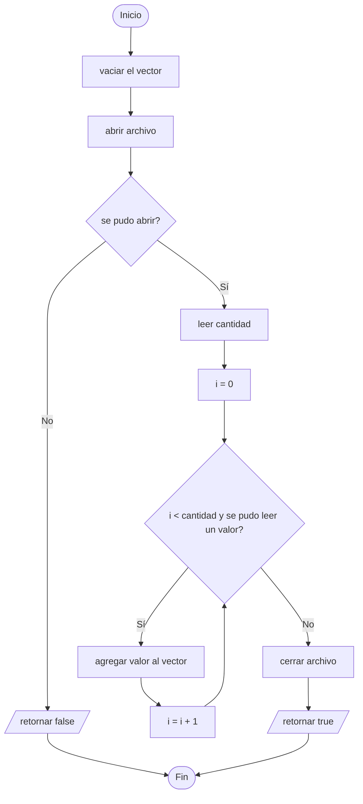

# A3 – Lista de números ordenada (sesión 14A)

> Ejercicio 3 de la sesión 14A: *lea un archivo con una lista de números enteros (el primer número del archivo es la cantidad total de números). Almacene la lista de números en un vector. Ordene el vector y muestre la lista ordenada. Implemente la búsqueda de un elemento en el vector.*

El archivo de este ejercicio trae **su propia cabecera**: el primer número no es un dato, es cuántos datos vienen.

## El formato del archivo

```
24
53 21 97 13 44 11 83 35 24 62 12 49
43 31 58 21 75 10 92 40 33 83 22 53
```

El `24` dice cuántos enteros hay que leer. Los saltos de línea **no importan**: `>>` salta cualquier espacio en blanco, incluido el salto de línea, así que el archivo podría estar en una sola línea o en veinticuatro.

```cpp
entero cantidad = 0;
entrada >> cantidad;

entero valor = 0;
for (entero i = 0; i < cantidad && entrada >> valor; i++) {
    numeros.push_back(valor);
}
```

La condición tiene dos partes: se leen **como máximo** `cantidad` números, y se para antes si el archivo se acaba. Confiar solo en la cabecera deja el programa a merced de un archivo mal escrito.

## Ordenar y buscar

```cpp
std::sort(numeros.begin(), numeros.end());
```

`sort` está en `<algorithm>` y ordena de menor a mayor. Recibe dónde empieza y dónde termina el rango, no el vector.

La búsqueda de este ejercicio es **secuencial**: recorre el vector comparando hasta encontrar el valor, y devuelve la posición o `-1`.

| | Secuencial (A3) | Binaria ([A4](../A4_CAleatorio)) |
|---|---|---|
| Necesita el vector ordenado | no | **sí** |
| Comparaciones en el peor caso | `n` | `log2(n)` |
| Con 24 elementos | hasta 24 | hasta 5 |
| Con 1 000 000 | hasta 1 000 000 | hasta 20 |

Aquí el vector ya está ordenado, así que la binaria sería posible: es justo lo que hace A4.

## Preguntas de la sesión

| Pregunta | Respuesta |
|---|---|
| ¿Por qué el primer número se lee aparte? | Porque es la cantidad, no un dato de la lista |
| ¿Afecta que los números estén en varias líneas? | No: `>>` salta todos los espacios en blanco |
| ¿Qué devuelve `buscar` si el valor no está? | `-1`, que no es una posición válida |
| ¿`sort` recibe el vector? | No, recibe `begin()` y `end()` |
| ¿Por qué no basta el `for` con la cantidad? | Si el archivo tiene menos números de los que dice, se leería basura |

## Diagrama de flujo – `leer_lista()`



## Ejecución

```
Ingrese el nombre del archivo: datos/numeros.txt
10, 11, 12, 13, 21, 21, 22, 24, 31, 33, 35, 40, 43, 44, 49, 53, 53, 58, 62, 75, 83, 83, 92, 97, 
Ingrese numero a buscar: 31
31 pertenece a la lista
```

```
Ingrese el nombre del archivo: datos/numeros.txt
10, 11, 12, 13, 21, 21, 22, 24, 31, 33, 35, 40, 43, 44, 49, 53, 53, 58, 62, 75, 83, 83, 92, 97, 
Ingrese numero a buscar: 30
30 no pertenece a la lista
```

## Tareas

- [ ] **1. El archivo de datos.** Revisa `datos/numeros.txt` y comprueba que el primer número coincide con la cantidad.
- [ ] **2. `leer_lista`.** Abrir, verificar, leer la cantidad y luego los valores.
- [ ] **3. La doble condición del `for`.** Que pare por cantidad **o** por fin de archivo.
- [ ] **4. `ordenar`.** Con `std::sort` y los iteradores del vector.
- [ ] **5. `mostrar`.** Los números separados por coma.
- [ ] **6. `buscar`.** Recorrido secuencial que devuelve la posición o `-1`.
- [ ] **7. `main`.** Pedir el archivo, ordenar, mostrar y buscar un valor.
- [ ] **8. Prueba los dos casos.** Un número que está y uno que no.
- [ ] **9. Rompe el archivo a propósito.** Cambia el `24` por `40` y comprueba que el programa no inventa números.
- [ ] **10. Para pensar.** El vector ya está ordenado cuando se busca. ¿Cómo cambiarías `buscar` para aprovecharlo?
