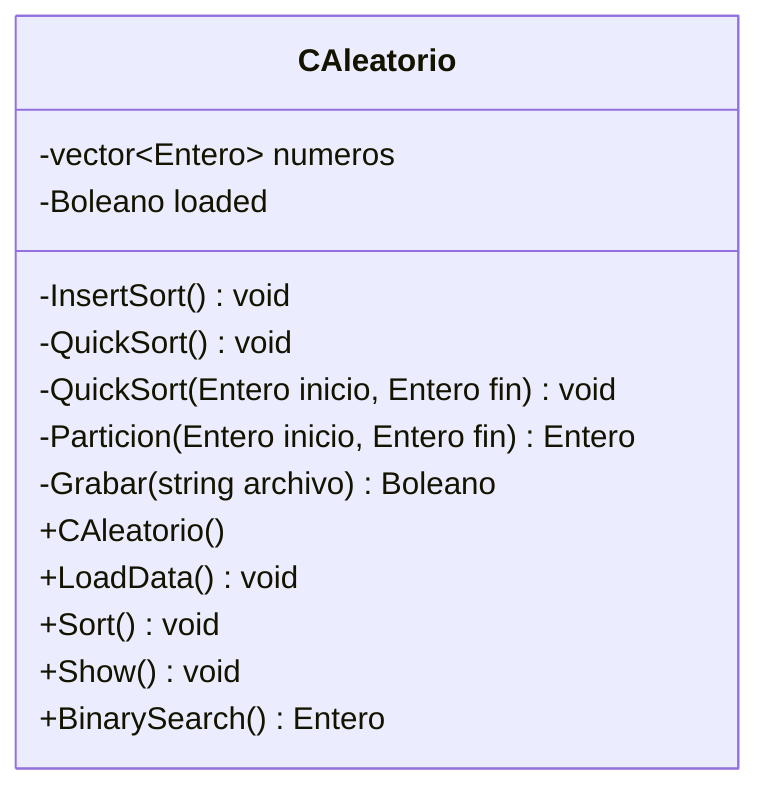
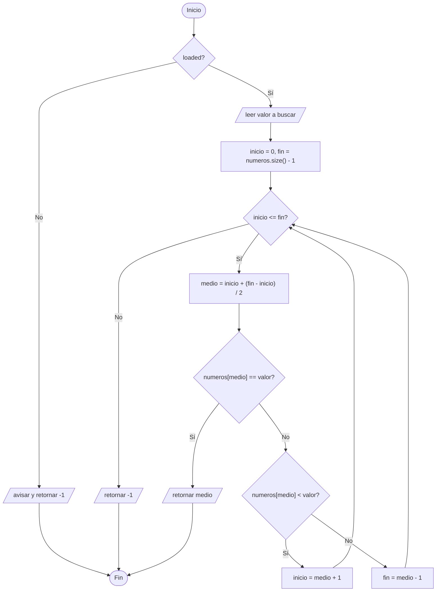

# A4 – Clase CAleatorio (sesión 14A)

> Ejercicio 4 de la sesión 14A: *cree una clase `CAleatorio` e implemente los siguientes métodos en la clase: `LoadData()`, `InsertionSort()`, `QuickSort()`, `BinarySearch()`. Que la función que genera el archivo ordenado no utilice un mapa al ordenar los elementos sino dos métodos privados que apliquen InsertionSort o QuickSort al vector que contiene los elementos leídos del archivo. Agregue un método a la clase para generar una búsqueda binaria sobre los elementos del archivo cargados en un vector.*

Es el ejercicio que junta **archivos y clase**: el vector con los datos del archivo pasa a ser un atributo, y leer, ordenar, grabar y buscar pasan a ser métodos.

## Diagrama de clase



**Lo privado es el cómo y lo público es el qué.** Quien usa la clase llama a `Sort()`; que por dentro sea inserción o quicksort no es asunto suyo. Por eso los dos algoritmos son privados.

`loaded` dice si ya hay datos. Sin él, `Sort()` y `BinarySearch()` trabajarían sobre un vector vacío sin avisar.

## La lectura hasta el final del archivo

```cpp
Entero valor = 0;
while (entrada >> valor) {
    this->numeros.push_back(valor);
}
```

A diferencia de [A3](../A3_ListaOrdenada), aquí el archivo **no dice cuántos números trae**. No hace falta: la extracción falla sola al llegar al final y el `while` termina. El vector crece con `push_back` según lo que vaya encontrando.

## Los dos ordenamientos

| | InsertSort | QuickSort |
|---|---|---|
| Idea | cada elemento retrocede hasta su lugar | partir en torno a un pivote y repetir |
| Estructura | dos bucles | recursión + `Particion` |
| Comparaciones (caso medio) | `n²` | `n·log n` |
| Con 30 números | se nota poco | se nota poco |
| Con 100 000 | minutos | instantáneo |

`QuickSort()` sin parámetros es el que se llama desde fuera; se apoya en la versión privada `QuickSort(inicio, fin)`, que es la recursiva. Son dos funciones con el mismo nombre y distinta lista de parámetros: **sobrecarga**.

`Particion` deja a la izquierda los menores o iguales que el pivote y devuelve la posición final de ese pivote, que ya no se vuelve a mover.

## La búsqueda binaria

```cpp
while (inicio <= fin) {
    entero medio = inicio + (fin - inicio) / 2;
    ...
}
```

Cada vuelta descarta la mitad de lo que queda. Eso **exige que el vector esté ordenado**: por eso en el `main` se llama a `Sort()` antes que a `BinarySearch()`. Sobre un vector desordenado el método no da error, da una respuesta equivocada, que es peor.

`medio` se calcula como `inicio + (fin - inicio) / 2` y no como `(inicio + fin) / 2` para que la suma no se desborde con vectores muy grandes.

## El archivo de salida

`Sort()` ordena y además graba `ordenados.txt`, un número por línea. Es el archivo que el enunciado pide generar, ahora sin ningún mapa de por medio.

## Preguntas de la sesión

| Pregunta | Respuesta |
|---|---|
| ¿Por qué `InsertSort` y `QuickSort` son privados? | Son el cómo; afuera solo se necesita `Sort()` |
| ¿Para qué sirve `loaded`? | Para no ordenar ni buscar sobre un vector vacío |
| ¿Por qué el `while (entrada >> valor)` no necesita la cantidad? | Porque la extracción falla al llegar al final |
| ¿Dos métodos `QuickSort` pueden llamarse igual? | Sí: tienen distinta lista de parámetros, es sobrecarga |
| ¿Qué pasa si busco sin ordenar? | La binaria responde mal: descarta la mitad equivocada |
| ¿Por qué el `main` usa `new` y `delete`? | El objeto se crea en el heap; lo que se reserva se libera |

## Diagrama de flujo – `BinarySearch()`



## Ejecución

```
Ingrese el nombre del archivo: datos/aleatorios.txt
Se cargaron 30 numeros
Ordenar con 1) InsertSort  2) QuickSort: 2
Lista ordenada grabada en ordenados.txt
2 5 7 8 12 13 16 19 24 26 30 35 39 41 47 48 52 54 58 61 67 68 71 73 79 84 88 90 93 95 
Ingrese numero a buscar: 54
Encontrado en la posicion 17
```

Primeras líneas de `ordenados.txt`:

```
2
5
7
8
12
```

## Tareas

- [ ] **1. `tipos.h`.** Los `using` de `Entero` y `Boleano` que usa la clase.
- [ ] **2. `CAleatorio.h`.** Atributos privados y la lista de métodos del enunciado.
- [ ] **3. Constructor.** Deja `loaded` en `false`.
- [ ] **4. `LoadData()`.** Pide el nombre, abre, verifica y carga con `while (entrada >> valor)`.
- [ ] **5. `InsertSort()`.** Ordenamiento por inserción sobre el atributo `numeros`.
- [ ] **6. `Particion()`.** Devuelve la posición final del pivote.
- [ ] **7. `QuickSort()`.** La versión pública sin parámetros y la privada recursiva.
- [ ] **8. `Grabar()`.** Escribe `ordenados.txt`, un número por línea.
- [ ] **9. `Sort()`.** Elige el algoritmo, ordena y graba.
- [ ] **10. `BinarySearch()`.** Pide el valor y devuelve la posición o `-1`.
- [ ] **11. `main`.** `new`, `LoadData`, `Sort`, `Show`, `BinarySearch` y `delete`.
- [ ] **12. Comprueba los dos algoritmos.** Corre con la opción 1 y con la 2: el resultado debe ser idéntico.
- [ ] **13. Para pensar.** ¿Qué pasaría si `BinarySearch()` se llamara antes que `Sort()`? Pruébalo comentando la llamada.
