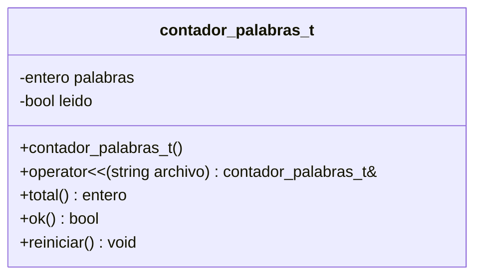
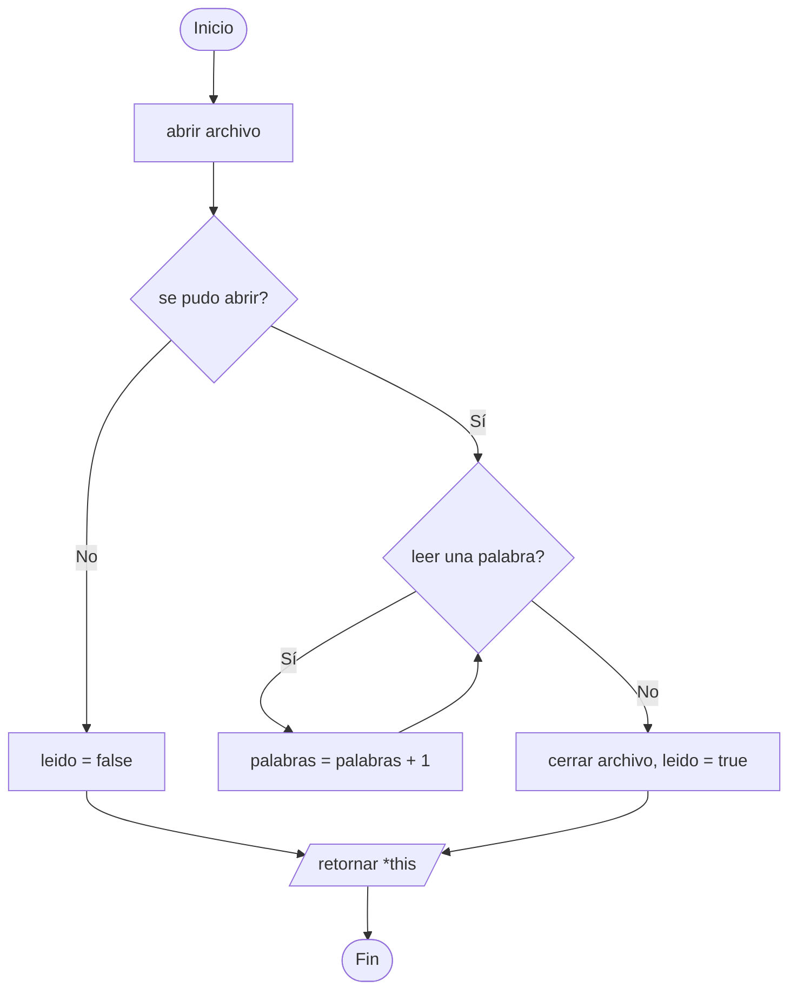

# A5 – Clase contador_palabras_t (sesión 14A)

> Ejercicio 5 de la sesión 14A: *crear un programa que cree una clase que se denominará `contador_palabras_t` y que cuente las palabras de un archivo y lo devuelva a través de un método. La lectura del archivo deberá realizarse usando el operador `<<` que debe ser sobrecargado, de modo que:*
>
> ```cpp
> contador_palabras_t contador;
> contador << "origen.txt";
> ```
>
> *Nota: como primera aproximación al problema considere el espacio como el carácter que define el fin o inicio de una palabra.*

Es el ejercicio donde se juntan **archivos** y **sobrecarga de operadores**: abrir y leer un archivo deja de ser una llamada a un método y pasa a escribirse como `<<`.

## Diagrama de clase



## Por qué el operador va como método

En `contador << "origen.txt"` el operando de la **izquierda** es el objeto de la clase. Esa es la condición para poder escribirlo como método:

```cpp
contador_palabras_t& contador_palabras_t::operator<<(const std::string& nombre_archivo);
```

El de la izquierda es el `this` y el de la derecha es el parámetro.

Es el caso contrario a `cout << objeto`, donde a la izquierda está el `ostream`: ahí el operador **no puede** ser método de la clase, porque el objeto de la izquierda no es de ella.

## Por qué devuelve una referencia

```cpp
return *this;
```

Devolver `contador_palabras_t&` permite encadenar:

```cpp
contador << "uno.txt" << "dos.txt";
```

`*this` es el objeto mismo, no una copia: la segunda lectura sigue sumando sobre el mismo contador.

## El conteo

```cpp
std::string palabra;
while (entrada >> palabra) {
    this->palabras++;
}
```

`>>` sobre un `string` **salta los espacios en blanco** y lee hasta el siguiente. Eso es exactamente lo que pide la nota del enunciado: el espacio delimita las palabras. Los saltos de línea y las tabulaciones cuentan como espacios, así que un archivo de varias líneas funciona sin ningún tratamiento especial.

Cada extracción exitosa es una palabra; cuando ya no hay nada que leer, el flujo falla y el bucle termina.

## Preguntas de la sesión

| Pregunta | Respuesta |
|---|---|
| ¿Por qué `operator<<` es método y no función libre? | Porque el objeto de la clase está a la izquierda |
| ¿Por qué devuelve una referencia y no `void`? | Para poder encadenar varias lecturas |
| ¿Qué devuelve `archivo >> texto` al llegar al final? | El propio flujo, que en una condición vale falso |
| ¿Cuenta bien si el archivo tiene varias líneas? | Sí: el salto de línea es un espacio en blanco más |
| ¿Y si hay dos espacios seguidos? | `>>` los salta todos: no cuenta palabras vacías |
| ¿Este `<<` tiene algo que ver con el de `cout`? | Es el mismo símbolo sobrecargado para otra clase |

## Diagrama de flujo – `operator<<`



## Ejecución

```
Ingrese el nombre del archivo: datos/origen.txt
El archivo tiene 30 palabras
```

## Tareas

- [ ] **1. La clase.** Atributos `palabras` y `leido`, ambos privados.
- [ ] **2. Constructor.** Contador en cero y `leido` en `false`.
- [ ] **3. `operator<<`.** Como método, recibe el nombre del archivo.
- [ ] **4. El tipo de retorno.** `contador_palabras_t&` y `return *this;`.
- [ ] **5. El conteo.** `while (entrada >> palabra)`.
- [ ] **6. `total()`.** Devuelve el conteo. Márcalo `const`.
- [ ] **7. `ok()`.** Para que el `main` sepa si el archivo se pudo abrir.
- [ ] **8. `main`.** Pide el nombre y usa el operador, no un método `leer()`.
- [ ] **9. El encadenado.** Prueba `contador << "datos/origen.txt" << "datos/origen.txt";` y comprueba que el total se duplica.
- [ ] **10. Para pensar.** ¿Qué habría que cambiar para contar también cuántas líneas tiene el archivo?
