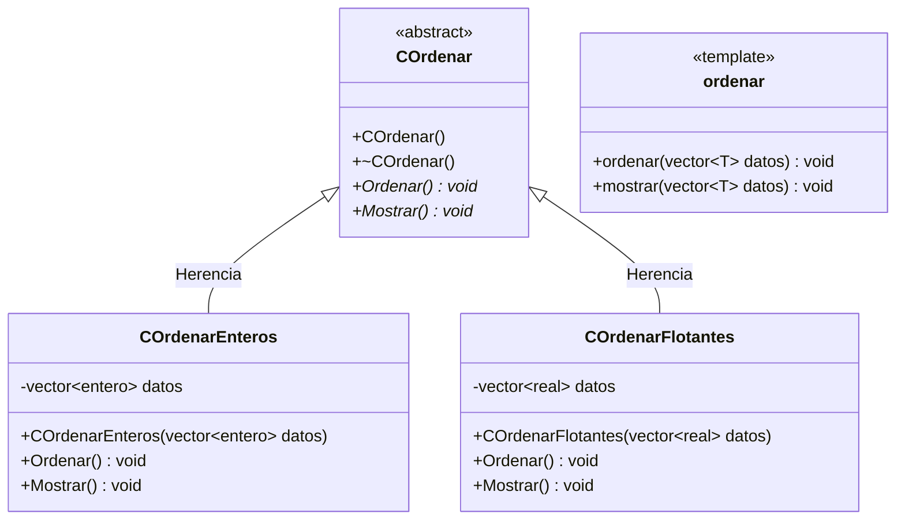

# B1 – Ordenación con herencia y con template (sesión 14A)

> Ejercicio 1 de templates de la sesión 14A: *escriba un programa que implemente un algoritmo de ordenación para números enteros y números de punto flotante.*
> *a) Implemente la solución con una clase `COrdenar` y con dos hijas `COrdenarEnteros`, `COrdenarFlotantes`.*
> *b) Implemente la solución usando `template`.*
> *c) Escriba un programa main que use las dos implementaciones.*
> *d) Discuta con sus compañeros ventajas y desventajas de ambas soluciones.*

El mismo problema resuelto de dos maneras, para poder compararlas. **El algoritmo es idéntico en las dos** (ordenamiento por inserción): lo único que cambia es el mecanismo que lo hace servir para varios tipos.

## Diagrama de clase



## a) La solución con herencia

`COrdenar` es abstracta: `Ordenar()` y `Mostrar()` son virtuales puras. Cada hija guarda **su propio vector**, de su propio tipo, y escribe **su propia copia** del algoritmo.

```cpp
vector<COrdenar*> ordenadores;
ordenadores.push_back(new COrdenarEnteros(enteros));
ordenadores.push_back(new COrdenarFlotantes(flotantes));

for (size_t i = 0; i < ordenadores.size(); i++) {
    ordenadores[i]->Ordenar();      // corre la version de cada hija
}
```

Punteros a la base y destructor virtual: las cuatro piezas del polimorfismo de inclusión, igual que en la [Semana 13](../../PO_UTEC_Semana13).

El precio está a la vista: `COrdenarEnteros::Ordenar()` y `COrdenarFlotantes::Ordenar()` son **la misma función escrita dos veces**, cambiando `entero` por `real`. Para agregar `double` hay que escribirla una tercera.

## b) La solución con template

```cpp
template <typename T>
void ordenar(std::vector<T>& datos) {
    ...
}
```

Una sola vez. El compilador fabrica una versión por cada tipo con el que se la llame, y las fabrica **solo si se usan**. `ordenar(palabras)` funciona con `vector<string>` sin que nadie lo haya previsto: basta con que el tipo sepa responder a `>`.

La plantilla va **completa en el `.h`**: el compilador necesita el cuerpo para generar cada versión.

## d) La comparación

| | Herencia (a) | Template (b) |
|---|---|---|
| Veces que se escribe el algoritmo | una por tipo | una sola |
| Agregar `double` | una clase nueva | nada |
| Tipos que soporta | los que se programaron | cualquiera con `>` y asignación |
| Cuándo se decide la versión | ejecución (`virtual`) | compilación |
| Se pueden guardar juntos en un vector | sí, `vector<COrdenar*>` | no: son tipos distintos |
| Cuándo aparece el error | al compilar la clase | dentro de la plantilla, con mensajes largos |
| Rama del cuadro de polimorfismo | universal → inclusión | universal → paramétrico |

No hay un ganador: la herencia sirve cuando cada tipo hace algo **distinto** y hay que tratarlos juntos; la plantilla sirve cuando todos hacen **lo mismo** y solo cambia el tipo. Aquí hacen lo mismo, así que la plantilla gana por economía — pero pierde la capacidad de meterlos a todos en un mismo vector.

## Preguntas de la sesión

| Pregunta | Respuesta |
|---|---|
| ¿Por qué `COrdenar` es abstracta? | Sus métodos son virtuales puros: no existe "ordenar en general" |
| ¿Por qué el vector es de punteros? | La clase es abstracta y una copia cortaría el objeto |
| ¿Cuántas funciones genera la plantilla? | Una por cada tipo que se use, y solo esas |
| ¿Por qué la plantilla va entera en el `.h`? | El compilador necesita el cuerpo para generarla |
| ¿Puedo tener `vector<ordenar>`? | No: `ordenar` no es un tipo, es una plantilla de función |
| ¿Qué pide la plantilla al tipo `T`? | Que se pueda copiar y comparar con `>` |

## Ejecución

```
--- Solucion con herencia ---
3 7 19 25 42 88 
0.5 1.25 3.125 4.5 9.75 

--- Solucion con template ---
3 7 19 25 42 88 
0.5 1.25 3.125 4.5 9.75 
kiwi manzana pera uva 
```

La tercera línea del segundo bloque es la prueba del argumento: ordena un `vector<string>` sin que se haya escrito nada para cadenas.

## Tareas

- [ ] **1. `COrdenar`.** Clase abstracta con los dos métodos virtuales puros y destructor virtual.
- [ ] **2. `COrdenarEnteros`.** Vector propio, constructor que lo recibe, `Ordenar()` y `Mostrar()` con `override`.
- [ ] **3. `COrdenarFlotantes`.** Lo mismo con `real`. Fíjate en cuánto código estás copiando.
- [ ] **4. El `main` con herencia.** `vector<COrdenar*>`, recorrido y `delete`.
- [ ] **5. `ordenar.h`.** La plantilla con el mismo algoritmo, una sola vez.
- [ ] **6. `mostrar` genérico.** La segunda plantilla.
- [ ] **7. El `main` con plantillas.** Las mismas listas, ahora sin clases.
- [ ] **8. La prueba del argumento.** Llama a `ordenar` con un `vector<string>`.
- [ ] **9. Agrega `double`.** Hazlo primero en la versión con herencia y después en la de plantillas. Cuenta las líneas.
- [ ] **10. Para pensar.** ¿Qué error da la plantilla si la llamas con un tipo que no tiene `operator>`?
