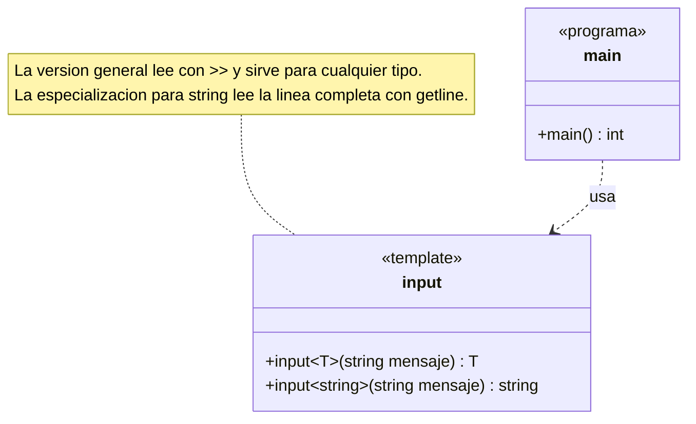

# B2 – Función genérica input (sesión 14A)

> Ejercicio 2 de templates de la sesión 14A: *escriba un programa que implemente la función genérica `input` similar a la función input de python:*
>
> ```python
> # python
> entero = int(input("Ingrese dato"))
> print (entero)
> ```
>
> ```cpp
> // C++
> auto entero = input<int>("Ingrese dato");
> cout << entero << endl;
> ```

En Python `input` siempre devuelve texto y hay que convertirlo (`int(...)`). En C++ se puede hacer mejor: **el tipo se pide en la llamada** y la función devuelve ya ese tipo.

## Diagrama de la plantilla



No hay clases: es una plantilla de función con una especialización. Las dos se llaman igual y el compilador elige según el tipo que se le pida en la llamada.

## La plantilla

```cpp
template <typename T>
T input(const std::string& mensaje) {
    T valor = T();
    std::cout << mensaje << ": ";
    std::cin >> valor;
    return valor;
}
```

Tres detalles:

- **`T valor = T();`** inicializa el valor en el cero de su tipo (`0`, `0.0`, cadena vacía). Una variable sin inicializar contiene basura si la lectura falla.
- **El tipo va explícito en la llamada**: `input<entero>(...)`. El compilador no puede deducirlo, porque `T` no aparece en los parámetros, solo en el retorno.
- **`auto`** del lado del que llama evita repetir el tipo: `auto numero = input<entero>("Ingrese dato");`.

## La especialización para cadenas

Con `>>` un `string` solo recibiría **una palabra**: `Carlos Palomino Vidal` se quedaría en `Carlos`. Como la `input` de Python devuelve la línea completa, se escribe una versión especial solo para ese tipo:

```cpp
template <>
inline std::string input<std::string>(const std::string& mensaje) {
    ...
    std::getline(std::cin, valor);
}
```

Eso es una **especialización**: la plantilla general sirve para todos los tipos menos para uno, que tiene su propia versión. El compilador elige la especializada cuando `T` es `std::string` y la general en los demás casos.

El `std::ws` antes del `getline` descarta los espacios y saltos de línea que hayan quedado pendientes de una lectura anterior.

| | Plantilla general | Especialización para `string` |
|---|---|---|
| Cómo lee | `cin >> valor` | `getline` |
| Hasta dónde | el primer espacio | el fin de línea |
| Sirve para | `int`, `float`, `double`, `char`… | solo `std::string` |

## Preguntas de la sesión

| Pregunta | Respuesta |
|---|---|
| ¿Por qué hay que escribir `input<entero>` y no basta `input`? | `T` no aparece en los parámetros: el compilador no puede deducirlo |
| ¿Para qué sirve `T valor = T();`? | Para que el valor devuelto no sea basura si la lectura falla |
| ¿Qué es una especialización? | Una versión propia de la plantilla para un tipo concreto |
| ¿Por qué `string` necesita una? | Porque `>>` solo leería una palabra |
| ¿Qué hace `std::ws`? | Descarta los espacios pendientes antes de leer la línea |
| ¿`auto` adivina el tipo? | No lo adivina: lo copia del tipo que devuelve la función |

## Ejecución

```
Ingrese dato: 25
25
Ingrese un numero real: 3.5
3.5
Ingrese su nombre completo: Carlos Palomino Vidal
Carlos Palomino Vidal
```

## Tareas

- [ ] **1. La plantilla.** `template <typename T> T input(const std::string& mensaje)`.
- [ ] **2. La inicialización.** `T valor = T();` antes de leer.
- [ ] **3. El `main`.** Llama a `input<entero>` y muestra el resultado.
- [ ] **4. Otro tipo.** Llama a `input<real>` sin tocar la plantilla.
- [ ] **5. Prueba el problema.** Llama a `input<std::string>` **sin** la especialización y escribe un nombre con espacios.
- [ ] **6. La especialización.** Escríbela con `getline` y vuelve a probar.
- [ ] **7. El `std::ws`.** Quítalo y mira qué pasa cuando antes hubo un `cin >>`.
- [ ] **8. Para pensar.** ¿Qué pasa si el usuario escribe letras cuando se pide un `entero`? ¿Cómo lo detectarías?
