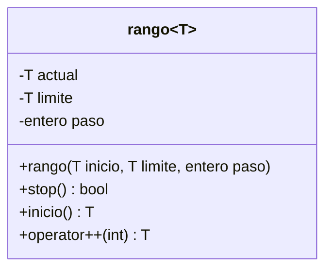
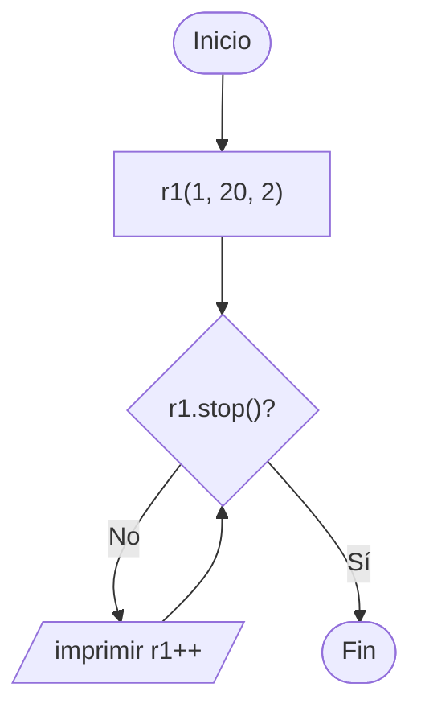

# B3 – Clase genérica rango (sesión 14A)

> Ejercicio 3 de templates de la sesión 14A: *escriba un programa que implemente la clase genérica `rango` que permita devolver un rango de valores:*
>
> ```cpp
> rango<int> r1(1, 20, 2);   // start = 1, stop = 20, step = 2
> while (!r1.stop())
>     cout << r1++ << " ";   // 1 3 5 7 9 11 13 15 17 19
>
> rango<char> r2('A', 'J');
> while (!r2.stop())
>     cout << r2++ << endl;  // 'A' 'B' 'C' 'D' 'E' 'F' 'G' 'H' 'I'
> ```

Una clase con plantilla, no una función. Reproduce el `range` de Python: **el valor inicial entra y el final queda fuera**.

## Diagrama de clase



## Las tres piezas

**El estado.** `actual` es el valor que todavía no se ha entregado; `limite` es dónde parar y `paso` cuánto avanzar. El `paso` tiene valor por defecto `1`, por eso `rango<caracter> r2('A', 'J')` funciona con dos argumentos.

**`stop()`.** Devuelve `true` cuando `actual >= limite`. Con `>=` y no con `>`, el límite queda **fuera** del recorrido: por eso `rango<int>(1, 20, 2)` termina en 19 y `rango<char>('A','J')` termina en `'I'`.

**`operator++(int)`.** El `int` del parámetro no se usa: es la marca que distingue el **post**-incremento (`r1++`) del pre-incremento (`++r1`). Post significa *entregar primero, avanzar después*:

```cpp
T operator++(int) {
    T copia = this->actual;                               // lo que se devuelve
    this->actual = static_cast<T>(this->actual + this->paso);  // el avance
    return copia;
}
```

El `static_cast<T>` hace falta porque sumar un `char` y un `int` da un `int`: sin la conversión, `rango<caracter>` no compilaría.

## Toda la clase en el .h

No hay `rango.cpp`. Una plantilla se define completa en el header porque el compilador necesita el cuerpo para generar la versión de cada tipo. Con `rango<entero>` y `rango<caracter>` en el `main`, el compilador fabrica **dos clases distintas** a partir de la misma plantilla.

## Preguntas de la sesión

| Pregunta | Respuesta |
|---|---|
| ¿Por qué `stop()` usa `>=` y no `>`? | Para que el límite quede fuera, como en Python |
| ¿Qué significa el `int` de `operator++(int)`? | Nada: solo marca que es el post-incremento |
| ¿Qué diferencia hay entre `r++` y `++r`? | `r++` devuelve el valor anterior; `++r` devolvería el ya avanzado |
| ¿Para qué el `static_cast<T>`? | `char + int` da `int`: hay que volver al tipo de la plantilla |
| ¿Por qué no hay `.cpp`? | Las plantillas van completas en el `.h` |
| ¿`rango<entero>` y `rango<caracter>` son la misma clase? | No: son dos clases generadas de la misma plantilla |

## Diagrama de flujo – el recorrido del `main`



## Ejecución

```
--- rango<entero>(1, 20, 2) ---
1 3 5 7 9 11 13 15 17 19 

--- rango<caracter>('A', 'J') ---
A B C D E F G H I 

--- rango<entero>(0, 5) ---
0 1 2 3 4 
```

## Tareas

- [ ] **1. La plantilla de clase.** `template <typename T> class rango`.
- [ ] **2. Los atributos.** `actual`, `limite` y `paso`, privados.
- [ ] **3. El constructor.** Con `paso` por defecto en `1`.
- [ ] **4. `stop()`.** Comparación con `>=`. Márcalo `const`.
- [ ] **5. `operator++(int)`.** Copia, avanza y devuelve la copia.
- [ ] **6. El `static_cast<T>`.** Quítalo y mira el error que aparece con `rango<caracter>`.
- [ ] **7. El `main`.** Los dos recorridos del enunciado.
- [ ] **8. Un tercer rango.** `rango<entero>(0, 5)` sin indicar el paso.
- [ ] **9. Para pensar.** ¿Qué pasa con `rango<entero>(20, 1, -2)`? ¿Qué habría que cambiar en `stop()` para que funcione hacia atrás?
