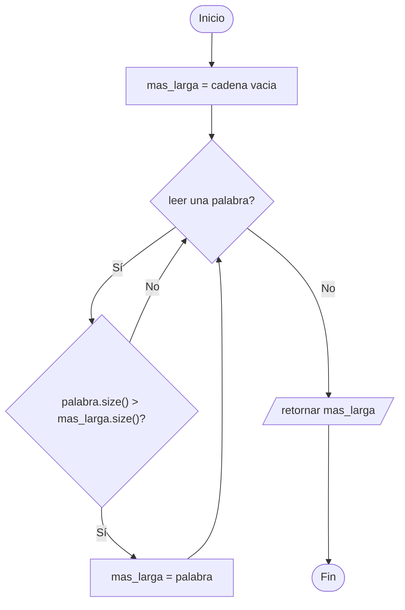
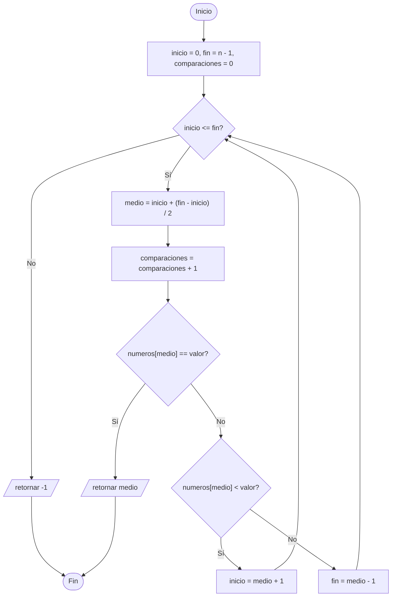
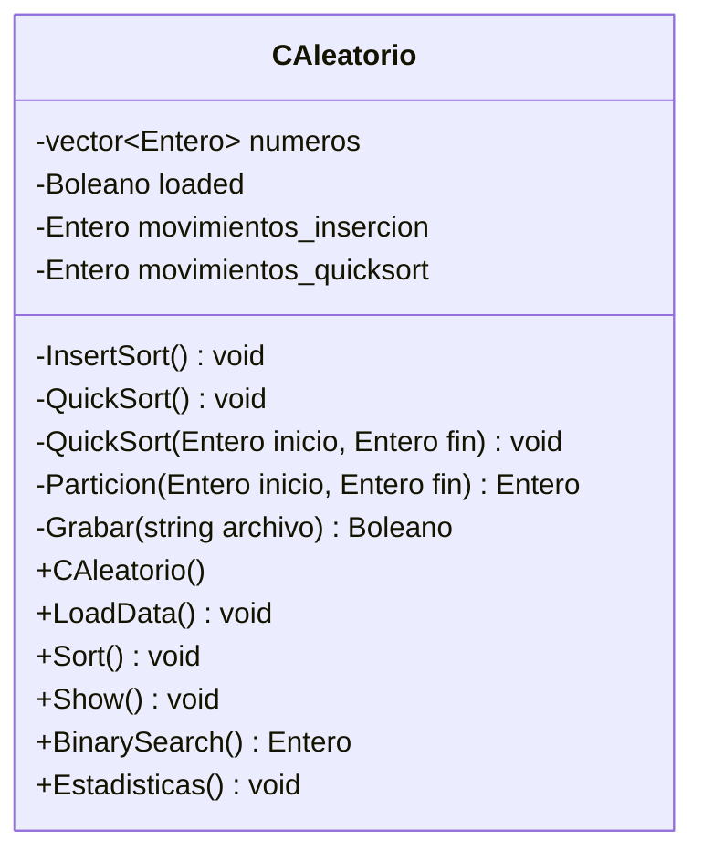
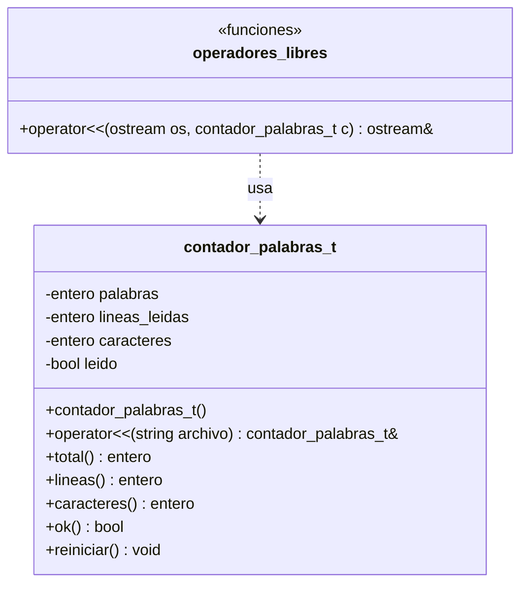
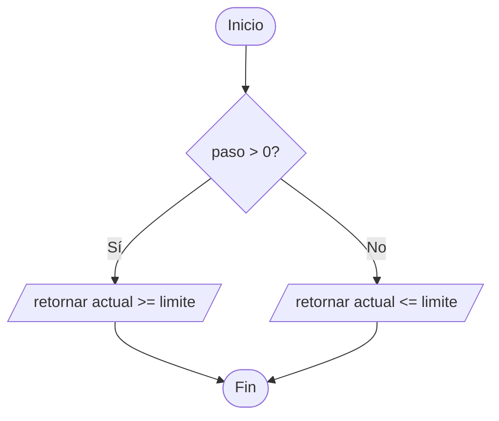

# Ejercicios propuestos – Semana 14 (Archivos)

Ejercicios adicionales para los alumnos que terminen antes. Solo usan lo visto hasta la Semana 14: **flujos de archivo, modos de apertura, lectura con `>>`, `getline` y `get`, escritura con formato, sobrecarga de operadores y templates**.

| # | Ejercicio | Tipo | Tiempo aprox. |
|---|-----------|------|---------------|
| 1 | Vocales → consonantes, palabras y la palabra más larga | Extensión de A1 | 20 min |
| 2 | Registro → volver a leer el archivo y sacar estadísticas | Extensión de A2 | 20 min |
| 3 | Registro → bitácora en modo `app` | Extensión de A2 | 15 min |
| 4 | Lista → búsqueda binaria y conteo de comparaciones | Extensión de A3 | 20–25 min |
| 5 | CAleatorio → contar intercambios de cada algoritmo | Extensión de A4 | 25 min |
| 6 | contador_palabras_t → líneas, caracteres y `operator<<` libre | Extensión de A5 | 20–25 min |
| 7 | `COrdenarGenerico<T>` como plantilla de clase | Reto (paramétrico) | 25 min |
| 8 | `rango` hacia atrás y con reales | Reto (paramétrico) | 20 min |

---

## 1. Vocales → consonantes, palabras y la palabra más larga

**Enunciado.** Con el programa de A1, agregue al recorrido del archivo tres datos más: cuántas **consonantes** tiene, cuántas **palabras** y cuál es la **palabra más larga**.

Las vocales y consonantes se cuentan carácter por carácter; las palabras, con una segunda pasada que lea con `>>` sobre un `string`. El archivo `vocales.txt` debe terminar con esas tres líneas adicionales.

*Restricción:* no se puede abrir el archivo tres veces. Abra una vez para los caracteres y otra para las palabras, y explique por qué no se puede hacer todo en una sola pasada con `get`.

**Conceptos:** elegir la forma de lectura según el dato buscado, reabrir un flujo, acumular varios resultados en un mismo recorrido.

**Diagrama de flujo – palabra más larga**



---

## 2. Registro → volver a leer el archivo y sacar estadísticas

**Enunciado.** El programa de A2 escribe el archivo pero nunca lo vuelve a leer. Agregue la función:

```cpp
std::vector<Persona> leer_registro(const std::string& nombre_archivo);
```

que abra el archivo generado, **salte las tres líneas de encabezado** y reconstruya el vector de personas. Después muestre el salario promedio, la persona de mayor salario y cuántas superan la edad promedio.

*Pista:* los encabezados se saltan con tres `getline` al inicio. El nombre tiene espacios, así que no se puede recuperar con `>>` sin más: conviene grabar en A2 con un separador, por ejemplo `;`, y leer con `getline(entrada, campo, ';')`.

**Conceptos:** un archivo que se escribe pensando en volver a leerlo, formato legible contra formato procesable, `getline` con delimitador.

---

## 3. Registro → bitácora en modo `app`

**Enunciado.** Agregue al programa de A2 una función `void registrar_evento(const std::string& texto)` que escriba en `bitacora.txt` una línea con la fecha y hora actual seguida del texto, **sin borrar las anteriores**.

Llámela al iniciar el programa, después de grabar el archivo y al terminar. Ejecute el programa tres veces y compruebe que la bitácora conserva las nueve líneas.

Responda: ¿qué pasa si abre `bitacora.txt` con `std::ofstream bitacora("bitacora.txt");` sin más?

**Conceptos:** `std::ios::app`, la diferencia entre crear y agregar, un archivo que sobrevive entre ejecuciones.

---

## 4. Lista → búsqueda binaria y conteo de comparaciones

**Enunciado.** Con el programa de A3, agregue la función:

```cpp
entero buscar_binaria(const std::vector<entero>& numeros, entero valor, entero& comparaciones);
```

y modifique también `buscar` para que cuente sus comparaciones. Busque el mismo valor con las dos y muestre cuántas comparaciones hizo cada una.

Pruebe con el primer elemento, con el último y con uno que no está. Responda: ¿en qué caso gana la secuencial?

**Conceptos:** medir en vez de suponer, parámetro por referencia como segundo resultado, el precio de exigir que el vector esté ordenado.

**Diagrama de flujo – `buscar_binaria()`**



---

## 5. CAleatorio → contar intercambios de cada algoritmo

**Enunciado.** Con la clase de A4, agregue dos atributos privados que cuenten cuántos **movimientos** hace cada algoritmo, y un método `void Estadisticas() const` que los muestre.

Ordene el mismo archivo primero con `InsertSort` y después con `QuickSort` (recargando los datos entre una y otra) y compare. Después genere un archivo con los números ya ordenados y vuelva a medir: ¿cuál de los dos se beneficia de que la entrada ya esté ordenada?

*Restricción:* no se puede cambiar la firma de `InsertSort()` ni de `QuickSort()`. Los contadores son atributos de la clase.

**Conceptos:** un atributo que acumula información del proceso, por qué el "mejor" algoritmo depende de los datos, reutilizar el objeto cargando datos otra vez.

**Diagrama de clase**



---

## 6. contador_palabras_t → líneas, caracteres y `operator<<` libre

**Enunciado.** Con la clase de A5:

1. Agregue los contadores de **líneas** y de **caracteres**, con sus métodos `lineas()` y `caracteres()`.
2. Sobrecargue además `operator<<` como **función libre** para volcar el resultado a un `ostream`:

```cpp
std::ostream& operator<<(std::ostream& os, const contador_palabras_t& c);
```

de modo que el `main` pueda escribir `cout << contador << endl;` y obtener las tres cifras en una línea.

Responda: ¿por qué el primer operador va como método y el segundo no puede ir como método?

**Conceptos:** la misma clase con un operador de cada clase, el criterio para decidir método o función libre, un objeto que se imprime solo.

**Diagrama de clase**



---

## 7. `COrdenarGenerico<T>` como plantilla de clase

**Enunciado.** En B1 la jerarquía necesita una clase por tipo y la plantilla de función no guarda estado. Escriba una tercera solución: una **plantilla de clase**

```cpp
template <typename T>
class COrdenarGenerico {
    std::vector<T> datos;
public:
    COrdenarGenerico(const std::vector<T>& datos);
    void Ordenar();
    void Mostrar() const;
};
```

Pruébela con `COrdenarGenerico<entero>`, `COrdenarGenerico<real>` y `COrdenarGenerico<std::string>`.

Responda: ¿se pueden guardar las tres en un mismo `vector`, como se hacía con `vector<COrdenar*>`? ¿Por qué?

**Conceptos:** plantilla de clase frente a plantilla de función, qué se gana y qué se pierde respecto de la herencia, por qué `COrdenarGenerico<int>` y `COrdenarGenerico<float>` no tienen ninguna relación de tipo entre sí.

---

## 8. `rango` hacia atrás y con reales

**Enunciado.** Con la clase de B3:

1. Haga que `rango<entero>(20, 1, -2)` funcione y produzca `20 18 16 ... 2`. *Pista: `stop()` no puede comparar siempre con `>=`; tiene que mirar el signo del paso.*
2. Pruebe `rango<real>(0.0f, 1.0f, 0.25f)` y explique por qué conviene que el paso tenga el mismo tipo que los valores y no sea siempre `entero`.
3. Agregue `operator++()` (pre-incremento) y muestre en el `main` la diferencia entre `r++` y `++r`.

**Conceptos:** una condición de parada que depende de un parámetro, el tipo del paso como tercer parámetro de la plantilla, pre-incremento y post-incremento como dos sobrecargas distintas del mismo operador.

**Diagrama de flujo – `stop()` con paso de cualquier signo**


